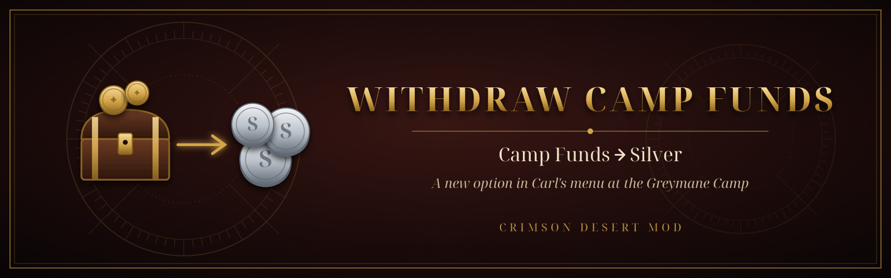
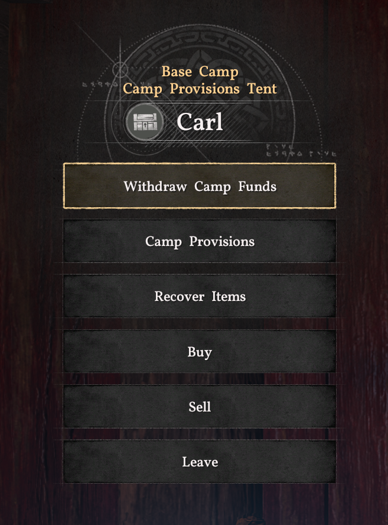
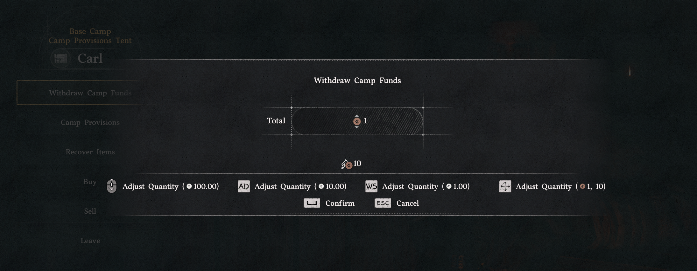

  

  
  
  
  
  
  

# Withdraw Camp Funds

**Your Greymane Camp is sitting on a fortune and you can't touch it.** This mod adds a
**Withdraw Camp Funds** option to Carl's menu at the Camp Provisions Tent, so you can turn Camp Funds
back into silver whenever you need it.

- **Fair rate, read from the game:** the exact inverse of the game's own donation rate. Silver is
  counted in copper (100 copper = 1 silver) and since patch 2.01 every copper donated gives 10 Camp
  Funds, so **10 Camp Funds give 1 copper, and 1,000 Camp Funds give 1 silver**. Whatever you donate,
  you can withdraw back exactly. If a future patch changes the donation rate, the withdrawal rate
  follows automatically.
- **Pick the amount:** the game's own quantity slider, with a confirmation, capped at what your Camp
  Funds allow.
- **Only where it belongs:** the option appears only in Carl's menu. Every other NPC, menu and button
  works exactly as before, and donating still works as usual.
- **Safe by design:** the conversion runs through the game's own camp-provisions transaction, so the
  game itself checks your balance and applies the change atomically. Nothing is written to disk and
  no game file is replaced.
- **Fail-closed:** after a game update, if anything it needs can't be found, the mod disables itself
  and says so in its log instead of guessing.

## Screenshots

  
  

## Requirements
- Crimson Desert **2.04.06** (Steam).
- An ASI loader. [Definitive Mod Manager](https://www.nexusmods.com/crimsondesert) 4.5.1+ already
  installs one (`winmm.dll` in `bin64/`).
- **Linux / Steam Deck (Proton):** the loader needs `winmm=n,b` in the launch options, for example
  `WINEDLLOVERRIDES="winmm=n,b" %command%` (add `winmm=n,b` to your existing overrides if you have
  any).

## Installation
**With DMM (recommended):** download the ZIP from
[Nexus Mods](https://www.nexusmods.com/crimsondesert/mods/3946) or the
[latest release](https://github.com/Marukooh/Camp-Funds-Withdraw/releases/latest), import it in
DMM, enable **CampFundsWithdraw** among the ASI mods and apply.

**Manual:** copy `CampFundsWithdraw.asi` and `CampFundsWithdraw.ini` into
`Crimson Desert/bin64/` (an ASI loader must already be installed there).

To uninstall, disable it in DMM or delete the two files.

## Usage
Talk to **Carl** at the Greymane Camp, choose **Withdraw Camp Funds**, pick the amount with the
slider (counted in copper, like the game's own donation) and confirm. Your Camp Funds go down by
10 × the copper you take: 1,000 Camp Funds for every silver.

## Configuration
`CampFundsWithdraw.ini`, next to the `.asi`:

| Key | Default | Meaning |
|---|---|---|
| `Enabled` | `1` | `0` turns the mod off |
| `MenuLabel` | `Withdraw Camp Funds` | text of the entry in Carl's menu |
| `Title`, `Text` | English | modal texts; `%RATE%`, `%FUNDS%`, `%MAX%` (copper), `%MAXSILVER%` and `\n` are supported |
| `ShowCostPreview` | `1` | also show the Camp Funds that will be spent under the slider |

## Troubleshooting
The mod writes `bin64/CampFundsWithdraw.log`. It should contain `ready` at startup and, when you
talk to Carl, `menu: added "Withdraw Camp Funds"`. If it says `disabled: game version not supported`,
the game was updated and the mod needs an update: please open an
[issue](https://github.com/Marukooh/Camp-Funds-Withdraw/issues) with the log attached.

## FAQ
**Does it work with my save?** Yes. It adds no new data to your save: it only moves Camp Funds to
silver through the game's own transaction. Removing the mod leaves your save untouched.

**Does it change donations or the Camp Provisions panel?** No. Donating and every existing button work
exactly as in the unmodded game.

**Other languages?** The menu entry and modal texts are configurable in the INI. The rest of the UI is
the game's own and follows your language.

## Building from source
Needs `mingw-w64` (`x86_64-w64-mingw32-g++`). Run `./build.sh` (plugin and offline signature checker)
or `tools/package.sh` (`dist/` with the ASI and INI). Every push is built by
[GitHub Actions](.github/workflows/build.yml).

## Also by me
[Custom Artifact Challenges Difficulty](https://www.nexusmods.com/crimsondesert/mods/3370): choose how
forgiving or demanding the Artifact Challenges are, with four presets (Cheat, Easy, Moderate, Hard)
for timers, counts and distance requirements, including Charting the Unknown.

## Contributing
Bug reports, compatibility notes for new game versions and pull requests are welcome: see
[CONTRIBUTING.md](CONTRIBUTING.md).

## License
Source-available, **all rights reserved**: you may read the code and contribute through pull requests,
but not copy, modify, redistribute or reuse it. Players may use the official release builds
unmodified. See [LICENSE](LICENSE), [NOTICE.md](NOTICE.md) and [CONTRIBUTING.md](CONTRIBUTING.md).

*Crimson Desert is a trademark of Pearl Abyss. This is an unofficial fan-made mod, not affiliated with
or endorsed by Pearl Abyss.*
